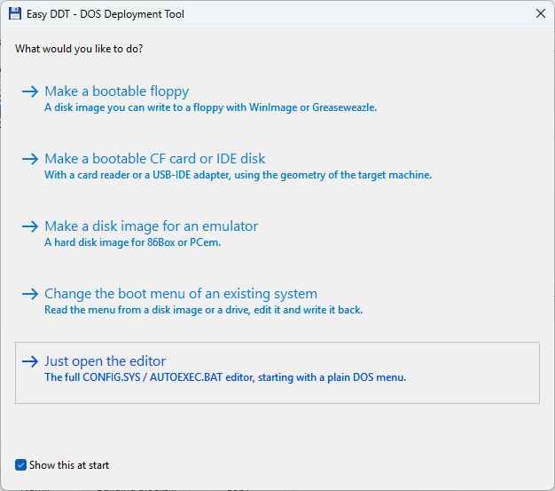

# Easy DOS Deploy

**Build bootable MS-DOS and FreeDOS systems with boot menus, and deploy them
to CF cards and IDE disks, from Windows.**

*Formerly Easy DDT; version 0.8.6 was released under that name.*

Easy DOS Deploy builds a complete DOS system for an old PC in a few steps:
the disk with the exact geometry the target machine's BIOS gives to DOS, the
DOS itself (installed from your MS-DOS Setup disks, or FreeDOS downloaded by
the program), the drivers, a **boot menu**, and your own games and tools. It
makes a disk image you can try in an emulator, then writes it to a
CompactFlash card or an IDE disk through a USB reader.

It writes the CONFIG.SYS / AUTOEXEC.BAT pair for MS-DOS 6.x and the
FDCONFIG.SYS style menu for FreeDOS, so you do not have to remember the
`[MENU]` / `MENUITEM` syntax or the `%CONFIG%` branches, and the files always
have DOS line endings.

## Status

Version 1.0. Tested on real hardware, an **Amstrad Integra 486 (Phoenix
BIOS)**:

* a backup of a working 1 GB CF card (MS-DOS 6.22), a new image with a
  generated boot menu made from it (1013/32/63, LBA), tried in 86Box, written
  back to the card and booted, with the menu working;
* the same system on an 8 GB Lexar card with another geometry;
* a FreeDOS card made from nothing (FreeDOS downloaded by the program, the
  program's own MBR), and the FreeDOS floppy with `GEOM.COM`.

Tested in 86Box: MS-DOS 6.22 installed from its three Setup disk images,
disks of 4 GB and 8 GB split into C: and logical drives (FDISK shows them as
its own, ScanDisk finds no errors), the user's own drivers and files. The
file generation, the importer, the FAT writer, the partitioning, the Setup
disk expansion, the image builder and the 16-bit code also have automated
tests. Other machines have not been tested on real hardware yet.
**Keep a copy of every disk image and card you work on.**

## What it does

* **A project in steps:** *Machine and disk*, *System*, *Drivers*, *Boot
  menu*, *Your files* and *Build*, each with its state at a glance. A
  start-up wizard leads through them. The project file keeps the whole
  recipe, so the same system can be built again, or for another card by
  changing only the geometry.
* **The exact geometry** of the target machine: from a disk profile, from
  the values in BIOS setup, from `GEOM.COM` run on the target machine, or
  from a backup of a working card.
* **The whole disk:** a disk bigger than 2 GB is split into C: and logical
  drives D:, E: ... of at most 2 GB, as FDISK would do it, so none of it is
  lost (or only C:, for CD-ROM games that need the CD-ROM as D:).
* **MS-DOS from its Setup disks:** the program expands your MS-DOS 6.x Setup
  disk images into C:\DOS, as Setup would, with Setup's choices for Backup,
  Anti-Virus, Undelete and DriveSpace. No need to run Setup on the target
  machine.
* **FreeDOS downloaded by the program** (kernel and FreeCOM, GNU GPL), or the
  system of a card or image that already boots.
* **Boot menu** for **MS-DOS 6.x** (`[MENU]` blocks) and **FreeDOS** (`MENU`
  lines and `1?` prefixes): ready menus from plain DOS to games and network,
  and a full editor with building blocks (memory manager, mouse, CD-ROM,
  Sound Blaster, network), a default item, a timeout and a preview.
* **Drivers:** free drivers are downloaded, the others (such as OAKCDROM.SYS)
  are browsed for in a file, a zip or a disk image, and you can add your own
  driver with its load line. See [Drivers](docs/DRIVERS.md).
* **Your files:** folders and files of the PC, such as games, utilities or
  Norton Commander, onto any drive of the DOS disk. Long names become 8.3
  names as DOS shows them.
* **Disk images** without mounting them: floppy images, hard disk images
  (86Box `.img`) and fixed-size `.vhd`, FAT12/16/32. An existing system's
  menu can be read, edited and written back; the old CONFIG/AUTOEXEC is kept
  as `.BAK`.
* **CF cards and IDE disks:** back up a card to an image, and write an image
  back, safely and quickly (only the used parts are written). See the
  [CF card guide](docs/CF-GUIDE.md).
* **User interface in English, German, French, Spanish, Italian and
  Hungarian;** other languages can be added with a text file. See
  [Translating](docs/TRANSLATING.md).

No MS-DOS files are included in the program or downloaded by it: MS-DOS
comes from your own disks.

## Quick start

1. Download the zip from the [Releases](../../releases) page and unpack
   `EasyDOSDeploy.exe` (Windows 10 or later, 64-bit). It is a single file; no
   installation.
2. Start it. The wizard asks what you want to make.
3. For a CF card or an IDE disk, read the [CF card guide](docs/CF-GUIDE.md)
   first: the geometry of the target machine matters.

Downloaded drivers, language files and settings are kept next to the program if
that folder is writable (portable use), otherwise in
`%APPDATA%\EasyDOSDeploy`.

## Documentation

| Document | Content |
|---|---|
| [CF card guide](docs/CF-GUIDE.md) | the steps of a project: geometry, big disks, where DOS comes from, your files, trying in 86Box, writing the card |
| [Old IDE disks](docs/OLD-IDE-DISKS.md) | disks a USB-IDE adapter cannot handle: a CF card as a helper, installing on the target machine, a PC with an IDE port |
| [Drivers](docs/DRIVERS.md) | the built-in driver list, where each driver comes from, adding your own |
| [Translating](docs/TRANSLATING.md) | adding a new language |
| [Building](docs/BUILDING.md) | building and testing from source |

## Repository layout

| Folder | Content |
|---|---|
| `src/` | the Windows program (Go) and its tests |
| `src/lang/` | the built-in German, French, Spanish and Italian translations |
| `src/tools/winres/` | makes the icon, version information and manifest of the exe |
| `asm/` | the 16-bit code: the MBR boot code and `GEOM.COM` with a tiny assembler, and the FreeDOS boot sector |
| `docs/` | the guides above and the screenshots |
| `.github/workflows/` | the GitHub Actions build |

## License

Copyright (C) 2026 Daniel Szentmiklosi.

GNU General Public License v3.0, see [LICENSE](LICENSE).

The drivers the program can download are separate programs under their own
licenses (mostly GPL or freeware) and are downloaded from their usual sources;
nothing of them is included here. MS-DOS is a trademark of Microsoft; no
Microsoft files are included or downloaded.
