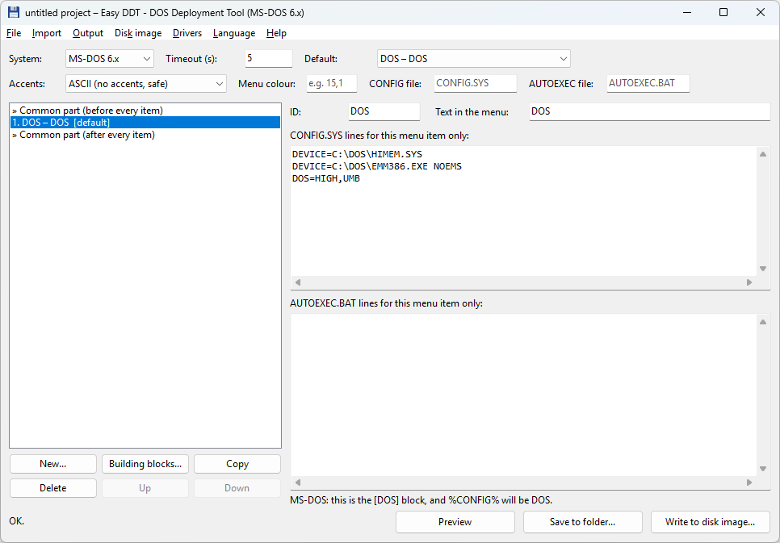

# Easy Retro System Builder

A Windows program that builds the **boot menu** of a DOS PC and puts it, with
the drivers it needs, onto a **disk image** or straight onto a **CompactFlash
card**. It writes the CONFIG.SYS / AUTOEXEC.BAT pair for MS-DOS 6.x and the
FDCONFIG.SYS style menu for FreeDOS, so you do not have to remember the
`[MENU]` / `MENUITEM` syntax or the `%CONFIG%` branches, and the files always
have DOS line endings.



## Status

Early version (0.x). Tested end to end on real hardware: a backup of a
working 1 GB CompactFlash card (MS-DOS 6.22) was made through a USB card
reader, a new bootable image with a generated boot menu was built from it
with the geometry the BIOS gives to DOS (1013/32/63, LBA mode), tried in
86Box, written back to the card, and an **Amstrad Integra 486 (Phoenix BIOS)**
booted from it with the menu working. The file generation, the importer, the
FAT12/16/32 writer and the image builder also have automated tests.
FreeDOS images and other machines have not been tested on real hardware yet.
**Keep a copy of every disk image and card you work on.**

## What it does

* **Boot menu editor.** Menu items with their own CONFIG.SYS and AUTOEXEC.BAT
  lines, plus common lines before and after them, a default item and a
  timeout. Output for **MS-DOS 6.x** (`[MENU]` blocks) or **FreeDOS**
  (`MENU` lines and `1?` prefixes). Preview before writing.
* **Start-up wizard:** pick what you want to make (bootable floppy, bootable
  CF card or IDE disk, emulator disk image, or a new menu for an existing
  system), then the DOS and the kind of menu.
* **Building blocks instead of typing:** tick memory manager (XMS / upper
  memory / EMS), mouse, CD-ROM, Sound Blaster sound (with UNISOUND for ISA PnP
  cards) and network (packet driver, mTCP, Easy Commander), and the program
  writes the lines for MS-DOS or FreeDOS. Ready combinations: plain DOS (the
  default), DOS + mouse, + CD-ROM, everything, games with and without EMS,
  network, clean boot. The lines can still be edited by hand.
* **Import an existing menu** from a disk image or a folder, including
  `INCLUDE=` blocks and both `IF "%CONFIG%"==` and `GOTO %CONFIG%` styles.
  Anything that cannot be mapped is listed, not silently dropped.
* **Drivers.** A built-in list of freely available drivers (Crynwr NE2000 and
  3C509 packet drivers, mTCP, CuteMouse, JemmEx, HimemX, UDVD2, SHSUCDX) that
  can be downloaded from the FreeDOS 1.3 package repository. Drivers that are
  not free to distribute, such as OAKCDROM.SYS from Windows 98, or that have no
  fixed download address, such as UNISOUND, are browsed for: a file, a zip, or
  a disk image (for example a Windows 98 boot floppy image), which the program
  searches for the file. The list can be edited in the program.
* **Write into disk images** without mounting them: raw floppy images, hard
  disk images with an MBR (86Box `.img`) and fixed-size `.vhd`, FAT12/16/32.
  The previous CONFIG/AUTOEXEC is kept as `.BAK`.
* **Make bootable disk images:** floppies from 360 KB to 2.88 MB, and hard
  disk / CF images with the exact cylinder/head/sector geometry the target
  machine's BIOS gives to DOS. The boot code and system files are taken from a
  bootable image you already have (for example a backup of a working card), so
  no MS-DOS files are distributed with the program.
* **CF cards:** back up a card from a card reader to an image file, read its
  geometry from the backup, and write an image back to a card. Only removable,
  USB and SD disks are offered, never the Windows disk. Before writing, the
  program shows what is on the disk now, warns loudly if it finds a Windows,
  Linux or GPT partition, and asks you to type the disk number. Empty areas are
  skipped and everything written is read back and compared. This also works
  with an IDE hard disk on a USB-IDE adapter (as long as the adapter can read
  the drive; very old CHS-only drives often cannot).
* **English and Hungarian** user interface; other languages can be added with a
  plain text file (Language > Make a translation file).

## Making a bootable CF card

The catch with CF cards is geometry: MS-DOS 6.22 boots with the
cylinders/heads/sectors that the BIOS reports, and these depend on the
machine, the adapter and the BIOS translation mode (NORMAL / LBA / LARGE).

1. Put the card into the target machine and boot DOS. Run `MSD.EXE`
   (Disk Drives) to see the geometry DOS gets, for example 1013 / 32 / 63.
   If the card already boots on that machine, a backup of it holds the same
   information (step 2).
2. *Disk image > Back up a card to an image file.* The program offers to
   read the geometry, boot code and system from the backup.
3. *Disk image > New bootable disk image:* check the geometry, choose the
   system source, and optionally copy the rest of its files and add the
   current menu with drivers. Save the geometry as a profile.
4. Try the image in 86Box with the **same** geometry.
5. *Disk image > Write an image to a card.* Needs administrator rights; the
   program offers to restart itself.

Do not change the BIOS drive settings afterwards, or the card will not boot.

## Download

Windows 10 or later, 64-bit. Download `EasyRSB.exe` from the
[Releases](../../releases) page. It is a single file; no installation.
Downloaded drivers, language files and settings are kept next to the program
if that folder is writable (portable use), otherwise in
`%APPDATA%\EasyRetroSystemBuilder`.

## Building

Go 1.24 or later, no other dependencies (plain Win32 calls, no cgo):

```
GOOS=windows GOARCH=amd64 go build -ldflags="-s -w -H windowsgui" -o EasyRSB.exe .
go test ./...
```

The tests run on any operating system. GitHub Actions builds the program for
every push and attaches it to a release for every `v*` tag.

## Translations

*Language > Make a translation file* writes a text file with every English
text and an empty line for the translation. Name it after the language code
(`de.lng`), put it into the `lang` folder and choose *Language > Reload
language files*. Pull requests with new languages are welcome.

## License

GNU General Public License v3.0, see [LICENSE](LICENSE).

The drivers the program can download are separate programs under their own
licenses (mostly GPL or freeware) and are downloaded from their usual sources;
nothing of them is included here. MS-DOS is a trademark of Microsoft; no
Microsoft files are included or downloaded.
